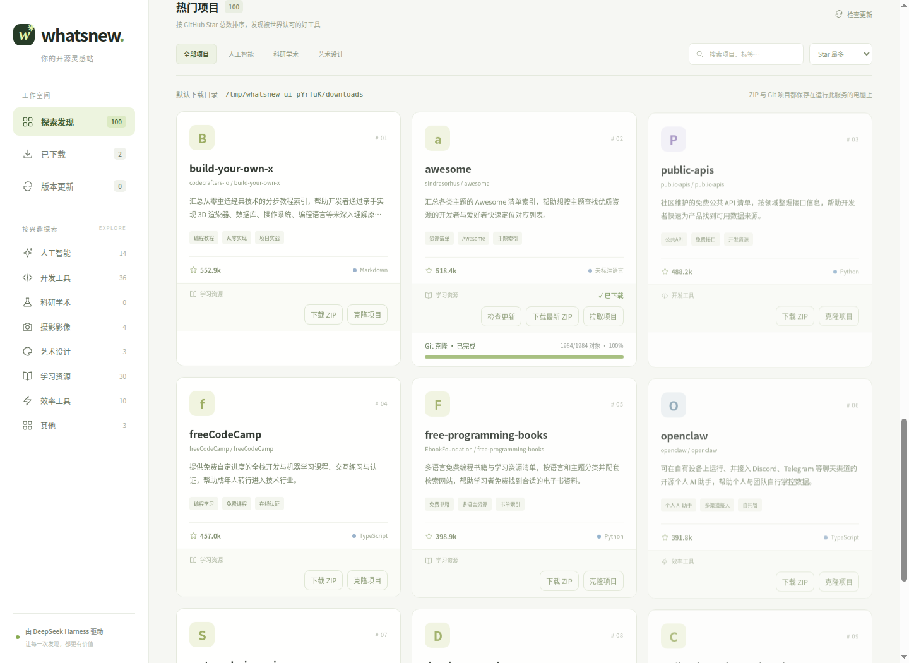
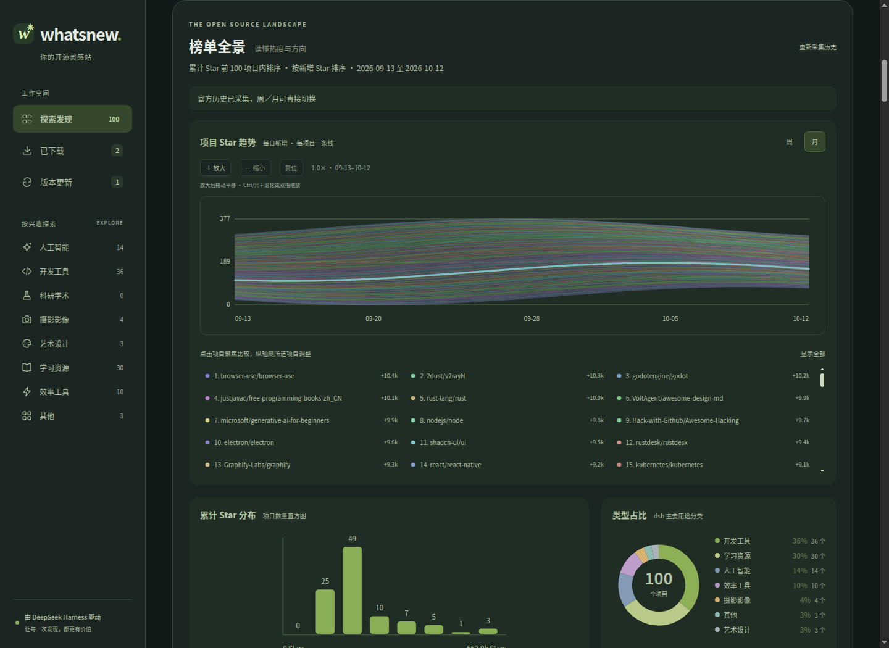
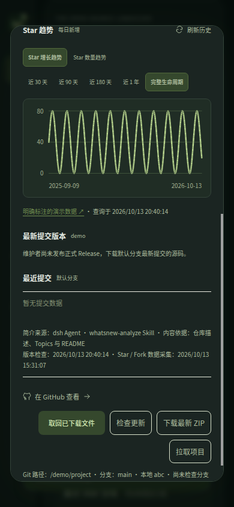

<p align="center">
  
</p>

<p align="center"><strong>开源世界，值得探索。</strong><br>发现热门项目，读懂能力与趋势，把灵感变成作品。</p>

<p align="center">
  <a href="#环境安装">环境安装</a> ·
  <a href="#功能快速使用">功能快速使用</a> ·
  <a href="#页面预览">页面预览</a> ·
  <a href="#问题处理">问题处理</a> ·
  <a href="docs/README.md">完整文档</a>
</p>

# WhatsNew · 开源雷达

WhatsNew 是一个 **DeepSeek Harness（dsh web）原生 Cordis 插件**，用中文网页探索 GitHub Star 总数前 100 的公开非 Fork 仓库。它通过模型生成项目简介、兴趣分类和标签，支持 Star 趋势比较、源码下载与版本跟踪，还能从项目能力中生成新构想、撰写本地网页 MVP。

**发现 → 分析 → 比较 → 下载 → 灵感 → 实现**，在一个本地工作空间里完成。支持桌面与手机、浅色与深色主题，分析结果和灵感可从本地缓存恢复。

## 环境安装

### 1. 准备环境

- **Node.js 22+**：提供 Node.js 与 npm。
- **DeepSeek Harness（dsh）**：在 `dsh web` 中配置可用模型。
- **Git（可选）**：克隆与拉取项目时需要。
- 正式分析需要联网访问 GitHub 和模型服务；建议配置 GitHub Token 以提高 API 额度。

```sh
npm install -g @deepseek-ai/dsh
dsh web
```

完成模型配置后，进入本项目目录。**无需安装本项目依赖或编译**。

### 2. 启动 WhatsNew

```sh
npm start
```

也可以双击对应启动文件：

| Windows | macOS | Linux |
| --- | --- | --- |
| `Start.bat` | `Start.command` | `WhatsNew.desktop` 或运行 `start.sh` |

启动后自动打开 **[http://127.0.0.1:3210](http://127.0.0.1:3210)**。保持启动终端打开，按 `Ctrl+C` 停止。升级后先停止旧服务，再重新启动。

独立启动器在 `.runtime/dsh` 创建 profile，通过路径复用已有 dsh 模型配置与凭证。若自定义 provider 依赖额外插件，使用[安装进已有 dsh web](docs/installation.md#安装进已有-dsh-web)的方式。不要同时启动两个使用相同端口的实例。

要随现有 `dsh web` 一起加载，在本项目目录执行 `npm run dsh:register`，然后重新启动 `dsh web`。插件库会显示 **WhatsNew · GitHub 开源雷达**、简介和绿色 logo；终端会打印 `[DSH 插件] … 已加载` 以及本机、局域网访问地址。注册后直接使用 `dsh web` 启动即可。

### 3. 开始探索

1. 打开左侧「设置」，保存独立 DeepSeek API Token（可选，未填写时沿用 dsh 模型），并按需配置 GitHub Token。
2. 点击 **一键分析**，等待项目卡片和趋势数据逐项出现。
3. 按兴趣筛选，点击卡片查看详情，下载源码或尝试生成灵感。

仅体验界面时，运行 `npm run demo`，打开 **[http://127.0.0.1:3211](http://127.0.0.1:3211)**。演示使用示例数据，不调用模型或执行下载。

更多启动方式、权限修复和已验证运行时见[安装与启动](docs/installation.md)。

## 功能快速使用

| 功能 | 快速操作 |
| --- | --- |
| **一键分析与恢复** | 点击「一键分析」准备项目简介和增星数据；中断后点击「继续分析」。刷新或重启会恢复缓存，顶部显示上次分析时间。 |
| **筛选、搜索与分页** | 点击兴趣分类或标签，输入关键词，选择 Star／增星／最近活跃／名称排序；热门卡片每页 9 个，通过底部页码切换。 |
| **榜单全景** | 在图内切换「Star 增长趋势／Star 累计数量」和周／月，项目图例随指标切换排序；点击图例聚焦多个项目，使用放大、缩小、拖动和复位比较曲线。 |
| **项目详情** | 点击卡片查看 Star、Fork、Release 附件下载量和最近提交；在趋势图切换每日新增／累计获星及时间范围。 |
| **下载与克隆** | 点击「下载 ZIP」或「克隆项目」，源码保存到服务电脑的 `downloads/`，卡片显示进度。ZIP 是源码包，克隆需要 Git。 |
| **我的下载** | 点击左侧「已下载」查看本地项目，即使尚未分析热门榜单也可使用；点击「检查更新」重新扫描，并分析榜单外项目。 |
| **版本更新** | 点击「检查更新」，再选择「下载最新 ZIP」或「拉取项目」。拉取采用 `--ff-only`，本地修改或分支状态不满足条件时会拒绝操作。 |
| **灵感乍现** | 100 个不同仓库全部通过分析后，手动点击「灵感乍现」生成一个构想；点击「换一换」探索新构想。 |
| **撰写网页 MVP** | 在灵感卡片点击「要我帮你实现吗？」，生成源码目录和 ZIP；进入生成目录运行 `npm start`，默认端口 `3215`。宿主不自动执行或发布。 |
| **主题与手机访问** | 右上角月亮／太阳切换主题；手机连接同一局域网，打开页面显示的 `192.168.*.*` 地址即可操作，无需配对。 |
| **设置与费用** | 在左侧「设置」保存／删除独立 DeepSeek API Token 和 GitHub Token；分析与灵感按钮旁分别显示本次 Token 和估算费用，自定义模型价格可在插件配置中填写。 |

操作细节见[功能使用指南](docs/usage.md)，Token、端口、局域网和模型价格设置见[配置与费用](docs/configuration.md)。

> 榜单按累计 Star 获取，增星排名只在这 100 个项目内比较；趋势中的每日新增不等于净增长，下载量仅统计 Release 附件。完整说明见[数据口径](docs/data-sources.md)。

## 页面预览

项目卡片与兴趣分类，支持源码下载、Git 克隆和版本检查：



<details>
<summary>查看更多：深色榜单全景与手机项目详情</summary>

**深色榜单全景**：比较项目每日新增 Star、累计 Star 分布和类型占比。



**手机项目详情**：查看完整生命周期趋势、Release 与提交信息。

<p align="center"></p>

</details>

截图复用已有界面验证素材，其中图表使用演示数据，仅用于展示交互和布局。更多说明见[截图画廊](docs/screenshots.md)。

## 问题处理

| 问题 | 处理方式 |
| --- | --- |
| 找不到 dsh 或模型不可用 | 确认 Node.js 22+，安装 dsh 并在 `dsh web` 配置模型；非标准安装可设置 `DSH_BIN`。 |
| 双击启动失败或页面打不开 | 从项目目录执行 `npm start` 查看终端错误；macOS 修复执行权限，Linux 首次选择「允许启动」。检查端口是否被占用。 |
| GitHub 限流、历史采集不完整 | 配置有效 GitHub Token，或等待额度恢复后点击「重新采集历史」。 |
| 分析中断、灵感按钮不可用 | 点击「继续分析」处理未通过项目；灵感需要 100 个不同仓库全部通过新版分析。 |
| ZIP、克隆或拉取失败 | 查看卡片下方错误后重试；克隆需要 Git，拉取前妥善处理本地修改与分支状态。 |
| 手机无法访问 | 确认处于同一局域网，使用页面显示的 `192.168.*.*` 地址，并检查服务电脑的防火墙。 |

逐项排查步骤见[问题处理指南](docs/troubleshooting.md)。

## 文档与开发

| 文档 | 内容 |
| --- | --- |
| [安装与启动](docs/installation.md) | 各系统启动、独立 profile、安装进 dsh web |
| [功能使用指南](docs/usage.md) | 分析、图表、下载、更新、灵感与 MVP |
| [配置与费用](docs/configuration.md) | Token、环境变量、监听地址、模型价格与计量 |
| [数据口径](docs/data-sources.md) | 榜单范围、官方历史、缓存与本地存储 |
| [问题处理](docs/troubleshooting.md) | 启动、分析、网络、下载和生成失败排查 |
| [开发指南](docs/development.md) | 源码结构、内置 Skills、结构化交付与验证命令 |
| [历史验证记录](docs/verification-history.md) | 既有实测与各版本回归记录 |

```sh
npm run check
npm test
```
